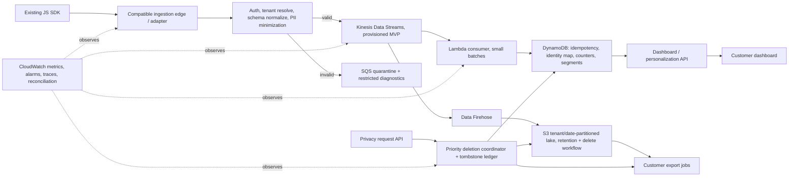

# Proposed architecture and operating decisions

## Flow

## Choices and tradeoffs

**Keep the public ingestion contract; replace the internals behind it.** Put a compatibility adapter in front of the new pipeline. It accepts the current SDK payload and endpoint, applies auth, canonicalizes known schema versions and validates required fields. Do not make a customer SDK update a cutover prerequisite. The current SDK source and its retry/ack semantics were not provided, so compatibility and durability behavior remain a discovery gate—not a claim.

**Kinesis Data Streams + Lambda for the MVP.** Provision capacity against known peak assumptions and pre-scale before planned events. A shard can accept 1 MB/s or 1,000 records/s; Kinesis charges by shard-hour and 25 KB PUT payload units. [AWS Kinesis pricing](https://aws.amazon.com/kinesis/data-streams/pricing/). Provisioned mode is chosen for forecastable volume and explicit cost/capacity control; on-demand is simpler operationally but must be checked for warm-throughput and sudden-spike behavior before relying on it. Keep the stream retention short unless replay needs justify the added cost. Kinesis is a buffer/replay boundary, not a substitute for client retry or a promise of exactly-once delivery.

**Pre-aggregate for the dashboard.** A Lambda consumer normalizes/idempotently applies records to tenant-scoped DynamoDB keys for recent counters, identity mappings, and segment membership; UI queries those compact views instead of scanning an event lake. Start with bounded sliding windows and a narrow set of rules (“pricing viewed at least three times”); add Managed Flink only when event-time windows, joins, or measured Lambda limits justify its operating complexity. Accept that DynamoDB counters require careful idempotency: write a tenant/event dedupe marker and update the aggregate transactionally or via an idempotent state transition.

**Firehose to S3 for replayable export/archive, not the hot path.** Firehose buffers and delivers the lake/export copy independently from the customer-facing aggregation. Firehose ingestion is billed in 5 KB increments; optional format conversion and dynamic partitioning are extra. [AWS Firehose pricing](https://aws.amazon.com/firehose/pricing/). Use a low-cardinality partition scheme first (tenant bucket/prefix plus date/hour) and avoid tiny objects. Exports to Snowflake/BigQuery use customer-scoped credentials and scheduled/bounded jobs; no warehouse is in the dashboard critical path.

**Why not make the MVP a broad data platform?** Kafka/MSK, Flink, OpenSearch, Redshift, a feature store, and a new customer SDK could all be defensible at larger scale, but each adds on-call surface, migrations, or cost. Two engineers and the three-month MVP constraint favor a managed queue, a simple consumer, a serving store, and an archive. PostgreSQL/Redis remain viable alternatives if the existing team already operates them and measured write/read patterns fit; benchmark before replacing managed defaults.

## Envelope and tenant-safe identity

Canonical envelope: `schema_version`, `tenant_id`, `event_id`, `type`, `ts` (event time, UTC), `received_at` (server time, UTC), `anonymous_id` or `user_id`, `properties` (allowlisted, size-limited), and optional `consent`/`region`. The edge derives `tenant_id` from authenticated credentials, not an untrusted body field. Reject or quarantine missing/invalid tenant, event ID, type, timestamp, or oversized payload. Keep direct identifiers (email/phone) out of analytics properties; tokenize or drop them before the stream. Do not emit property values to logs.

Partitioning, dedupe, serving keys, export paths, access policies, and identity-map keys all include `tenant_id`. An `identify` event links an anonymous key to an authenticated customer key only inside that tenant. A conflicting mapping is quarantined for review; no cross-tenant stitching. Reversible identity data lives in a separately permissioned, encrypted store with a short TTL and audit trail. This fixture demonstrates identities (e.g. `evt-0003`, `evt-0008`, `evt-0022`) but cannot prove real-world merge quality.

## Reliability contract

Use **at-least-once** delivery from edge to durable stream, then idempotent consumers keyed by `(tenant_id,event_id)`. Return success to the SDK only after Kinesis confirms the write. For partial `PutRecords` failures, retry only failed records with bounded exponential backoff and jitter; retain a durable quarantine/DLQ record for non-retryable failures. Consumer checkpoints advance only after downstream effects are committed. Duplicates are expected and suppressed; ordering is only per partition key. Do not say “zero loss”: before edge acknowledgement, browser shutdown, network loss, ad blockers, and SDK behavior are outside server control. Confirm SDK retries, browser batching, timeout behavior, and idempotency before making a stronger end-to-end claim.

On overload, shed non-critical enrichment first, preserve privacy-control work, apply per-tenant quotas, return retryable errors before accepting data the stream cannot durably take, and alarm on oldest-record age/backlog. Dashboard freshness degrades visibly (“data delayed”) rather than silently returning stale data as live. Track accepted/rejected counts, partial writes, duplicate rate, quarantine reasons, per-tenant lag, Lambda iterator age/errors, DDB throttles, S3/Firehose delivery errors, delete completion, and reconciliation deltas. Compare edge-accepted counts to stream-processed counts by tenant/time bucket and replay bounded windows from the stream/archive.

## Privacy and deletion

Treat a deletion request as priority control-plane work, not an analytics event. Authenticate/verify it, resolve the tenant-scoped subject, write a durable tombstone, suppress future events, then delete or recompute records in identity maps, DDB aggregates/segments, export staging, and lake partitions/indexes. Lake objects may contain many users, so maintain a subject-to-object index or use sufficiently fine-grained deletion units; rewrite affected objects and verify no subject remains in query paths. Keep only a legally permitted audit proof. Backups and customer-owned warehouse copies have separate retention/notification procedures; state the applicable completion SLA and lawful retention with counsel/customer rather than promising instantaneous erasure. SOC 2/GDPR/CCPA are controls and processes to validate, not badges this proposed system already holds.

## Migration and delivery scope

1. Inventory current endpoints, SDK versions, auth, payload sizes, retry behavior, dashboards, and peak traces. Capture a baseline before changing routing.
2. Deploy the adapter and stream in shadow mode: mirror only server-received traffic (avoid duplicate browser sends), retain existing serving as source of truth, and compare per-tenant counts, schema, identity, segment results, and freshness.
3. Canary internal plus opt-in tenants. Require no unexplained count divergence, privacy workflow drills passing, tested replay, and agreed latency/error thresholds before each expansion.
4. Gradually shift reads to new materialized views, with tenant-level feature flags. Keep rollback by switching reads and writes back to the existing pipeline; do not dual-write from clients. Drain/reconcile in-flight buffers before retiring the old processor.
5. Roll back on rising missing/duplicate divergence, breach of agreed freshness/error budget, cross-tenant access incident, deletion verification failure, or sustained consumer lag beyond the recovery window.

The three-month MVP covers adapter, Kinesis, Lambda rules, DDB aggregates, basic dashboard freshness, quarantine, one export path, deletion runbook, metrics, replay, and canary migration. Full warehouse connectors, complex event-time semantics, advanced ML personalization, multi-region active-active, and independent compliance certification are staged beyond MVP. Keep delivery realistic for two dedicated senior engineers; dates are planning targets, not measured estimates.
